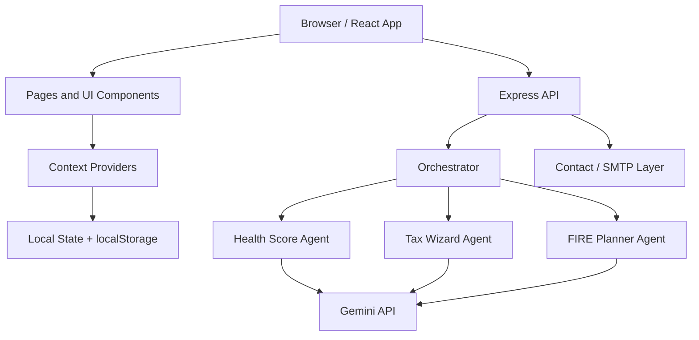

# AI Money Mentor — Architecture

## Overview

AI Money Mentor is a layered application designed around a simple financial-journey flow: user enters financial data, a frontend computes or prepares the input, a backend orchestrates domain-specific analysis, and a Gemini-based AI returns actionable guidance.

The project is structured as a Vite React app with an Express API and specialized agent modules. It models a lightweight personal-finance workspace rather than a fully enterprise-grade banking system.

## High-level architecture

## Frontend architecture

The React application lives in `src/` and is organized around pages and context-managed app state.

### Key frontend pieces

- `src/App.jsx`
  - Root app shell.
  - Hosts the global routing, sidebar layout, paywall flow, and review modal.

- `src/context/`
  - `AuthContext.jsx`: demo authentication state.
  - `CreditContext.jsx`: credit management and paid access gating.
  - `ReviewContext.jsx`: review modal lifecycle and persistence.
  - `ThemeContext.jsx`: theme toggle state.

- `src/pages/`
  - `HealthScore.jsx`: financial health questionnaire and scoring.
  - `TaxWizard.jsx`: old/new regime comparison and deductions overview.
  - `FirePlanner.jsx`: retirement target calculation and SIP roadmap.

- `src/lib/`
  - Shared formatting and local storage helpers.

## Backend architecture

The API server is initialized in `server/index.js` and exposes a compact set of endpoints for analysis and contact submission.

### Core backend endpoints

- `POST /api/health-score`
- `POST /api/tax-wizard`
- `POST /api/fire-planner`
- `POST /api/contact`
- `GET /api/health`

### Request lifecycle

1. The client collects user answers, calculations, or plan inputs.
2. The frontend sends a JSON payload to the backend.
3. The Express app validates the presence of required data and applies rate limiting.
4. The orchestrator routes work to the relevant domain agent.
5. The agent builds a prompt and calls Google Gemini.
6. The response is returned to the user as AI insights.

## Orchestration model

Each analysis flow is intentionally separated so the system can reason within a specific domain:

- Health score agent: confidence/coverage scoring, recommendations, and core financial wellness checks.
- Tax wizard agent: Indian tax regime logic, deduction opportunities, and tax optimization guidance.
- FIRE planner agent: retirement number modeling, SIP recommendations, and long-term portfolio advice.

The orchestrator keeps these calls cohesive while preserving a single API surface for the app.

## Data flow

### Health score

- User answers intake questions.
- Frontend computes a score object.
- Scores and answer payload are sent to `/api/health-score`.
- AI returns narrative recommendations.

### Tax wizard

- User enters gross income, salary assumptions, and deductions.
- Frontend computes old/new regime values locally for display.
- JSON is sent to `/api/tax-wizard`.
- Agent uses the results in the prompt for personalized guidance.

### FIRE planner

- User enters age, income, expenses, savings, and risk profile.
- Frontend calculates the FIRE plan and request payload.
- Backend routes to the FIRE planner agent for narrative insights.

## Operational considerations

### Current implementation profile

- The app is designed as a demo and portfolio project.
- Client-side state and `localStorage` are used to minimize setup cost.
- Auth and premium access are lightweight and suitable for prototype validation, not production banking-grade security.

### Production hardening opportunities

- Move authentication to a secure server-side session or JWT-based flow.
- Store user credentials in a hashed and salted form.
- Validate and sanitize all request bodies more aggressively.
- Restrict CORS to known production origins.
- Replace browser-local subscription checks with backend-enforced entitlement logic.

## Technology summary

- React for interface composition and interactive dashboards
- Vite for fast development and production builds
- Express for the API layer and orchestrated AI calls
- Google Gemini for reasoning and personalization
- Chart.js for financial data visualization
- Nodemailer for contact-form support

## Result

The result is an accessible financial planning app that blends educational UX, domain-specific reasoning, and a simple multi-agent backend pattern. It is intentionally lightweight and pragmatic, which makes it suitable for demos, hackathons, and early-stage product validation.
